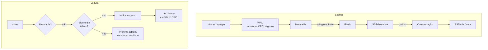

# lsm-store

Motor de armazenamento chave-valor com LSM-tree, escrito do zero: WAL com CRC, memtable, SSTables, filtro de Bloom, compactação e recuperação de queda testada byte a byte. TypeScript, Node 24, zero dependências.

[](https://github.com/luizrenatodc/lsm-store/actions/workflows/testes.yml)
[](LICENSE)

```ts
import { Motor } from "./src/motor.ts";

const banco = new Motor("./dados");
banco.colocar("usuario:1", "Ana");
banco.obter("usuario:1");                    // "Ana"
banco.apagar("usuario:1");
[...banco.faixa("usuario:", "usuario;")];    // leitura ordenada por faixa
banco.fechar();
```

## Por que este projeto existe

RocksDB, LevelDB e Cassandra usam esta mesma estrutura. O objetivo aqui é entender onde um banco realmente perde dados: entre um `write` e um `fsync`, entre gravar um arquivo e publicá-lo, na cauda rasgada de um log. Por isso a parte central do projeto é a suíte de queda, não a API.

## Como funciona



### Formato da SSTable

```text
┌─────────────────────────────────────────────┐
│ blocos de ~4 KB, ordenados, cada um com CRC │
├─────────────────────────────────────────────┤
│ índice esparso: primeira chave de cada bloco│
├─────────────────────────────────────────────┤
│ filtro de Bloom, ~10 bits por chave         │
├─────────────────────────────────────────────┤
│ rodapé de 40 bytes: posições, CRCs, número  │
│ mágico, com CRC próprio                     │
└─────────────────────────────────────────────┘
```

## Durabilidade

O ponto delicado é a ordem das operações em um flush:

1. A nova tabela é gravada em arquivo temporário, com `fsync`, e renomeada.
2. O manifesto novo é gravado da mesma forma. **É este passo que publica a tabela.**
3. Só então o WAL antigo é apagado.

Uma queda entre os passos deixa o estado anterior íntegro. O que sobrou sem estar no manifesto é removido na abertura.

## Como a recuperação é verificada

| Teste | O que prova |
|---|---|
| **WAL cortado em cada byte** | Para todo tamanho possível do log, a recuperação devolve exatamente um prefixo das escritas e continua aceitando novas gravações |
| **Queda em 5 pontos** | Falha injetada antes e depois da tabela, depois do manifesto e nas duas fases da compactação: nada se perde e nenhuma chave apagada ressuscita |
| **Byte trocado no WAL** | A recuperação para no ponto corrompido, sem devolver dado errado |
| **Bloco corrompido** | Vira erro explícito, nunca um valor incorreto |
| **Modelo** | 40 mil operações aleatórias comparadas com um `Map`, atravessando reaberturas e compactações |

O teste de cada byte pegaria um defeito clássico: sem truncar a cauda ruim, as próximas escritas ficam depois do lixo e se perdem na recuperação seguinte. Essa asserção faz parte dele.

No total são 15 testes, em cerca de 45 segundos.

## Medições

Saída de `npm run bench`: Node 24.14, Intel i5-13420H, Windows 11, SSD de notebook. São 300 mil chaves com valores de 100 bytes, memtable de 1 MB, sem `fsync` por escrita. Números de uma única execução, úteis para comparar configurações, não como referência absoluta.

| Gatilho de compactação | Escrita (ops/s) | Amplificação de escrita | Tabelas no fim | Leitura de chave presente (ops/s) | Leitura de chave ausente (ops/s) |
|---:|---:|---:|---:|---:|---:|
| 4 | 12.963 | 11,30x | 1 | 13.337 | 994.536 |
| 8 | 22.051 | 6,52x | 1 | 14.676 | 1.064.695 |
| 16 | 29.326 | 3,65x | 13 | 12.999 | 265.846 |

Com `fsync` a cada escrita, a vazão cai para **1.187 ops/s**.

**Como ler a tabela:**

- **Compactar mais cedo custa caro.** Do gatilho 16 para o 4, a escrita perde mais da metade da vazão e grava três vezes mais bytes. É o trade-off central de toda LSM-tree.
- **O Bloom faz o que promete.** Chaves ausentes leram 0,000 blocos em média, e a leitura presente ficou entre 1,00 e 1,08 blocos.
- **Mais tabelas pesam na leitura ausente.** Com 13 tabelas, cada busca consulta 13 filtros, e a vazão cai para cerca de um quarto.
- **`fsync` domina tudo.** Daí a opção `sincronizar`, e o motivo de bancos reais agruparem commits.

## Decisões técnicas

**CRC por registro e por bloco.** Sem isso, um setor corrompido vira dado errado em silêncio.

**Manifesto como ponto único de publicação.** O que define o estado do banco é um arquivo pequeno, trocado por renomeação atômica. Não há estado intermediário visível.

**Índice esparso em vez de um índice por chave.** Mantém em memória uma entrada por bloco, ao custo de ler um bloco inteiro por busca.

**Lápides só somem na compactação total.** Remover uma lápide com dados mais antigos ainda em outra tabela ressuscitaria a chave. Como a compactação aqui une tudo, é seguro.

**Pontos de falha injetáveis.** O gancho `pontoDeFalha` permite parar em um passo exato do flush, tornando determinístico o que normalmente depende de sorte.

## Como rodar

Requer Node 24 ou superior. Não há nada para instalar.

```bash
npm test
npm run bench
```

## Estrutura

```text
src/formato.ts   codificação binária, CRC32 e filtro de Bloom
src/sstable.ts   escrita e leitura de tabelas imutáveis
src/motor.ts     WAL, memtable, manifesto, flush e compactação
test/            suíte de queda, modelo e corrupção
scripts/bench.ts medições
```

## Limites conhecidos

- **Queda simulada, não queda de energia.** Os testes cortam arquivos e interrompem o processo. Nenhum teste prova o que o sistema operacional ou o disco fazem com `fsync` em uma falta de luz real, nem o `fsync` do diretório, que não é feito depois do `rename`.
- **Compactação total e síncrona.** Toda compactação reescreve o banco inteiro e bloqueia as escritas. Por isso a amplificação cresce com o volume. O próximo passo seria compactação em níveis e em segundo plano.
- **Sem cache de blocos.** Cada busca lê do disco e decodifica o bloco em JavaScript, o que explica as cerca de 13 mil leituras por segundo.
- **Abertura lê todas as tabelas** para descobrir a maior sequência. Gravar esse número no manifesto eliminaria o custo.
- **Um único processo e uma thread.** Não há trava de arquivo contra dois processos na mesma pasta, nem snapshots ou transações.
- **Faixa percorre as tabelas desde o início**, sem usar o índice para saltar ao ponto inicial.
- **`seq` em `number`.** Seguro até 2^53.

## Referências

- O'Neil et al., *The Log-Structured Merge-Tree* (1996)
- Pillai et al., *All File Systems Are Not Created Equal* (OSDI 2014), sobre o que `fsync` e `rename` realmente garantem
- Documentação de formato do LevelDB

## Sobre este projeto

Projeto de demonstração, criado para mostrar a abordagem técnica. Não é indicado para guardar dados de produção.

## Autor

**Luiz Renato Carvalho**, Engenheiro de Software e IA · [luizrenato.dev](https://www.luizrenato.dev) · [LinkedIn](https://linkedin.com/in/luizrenatodc)
